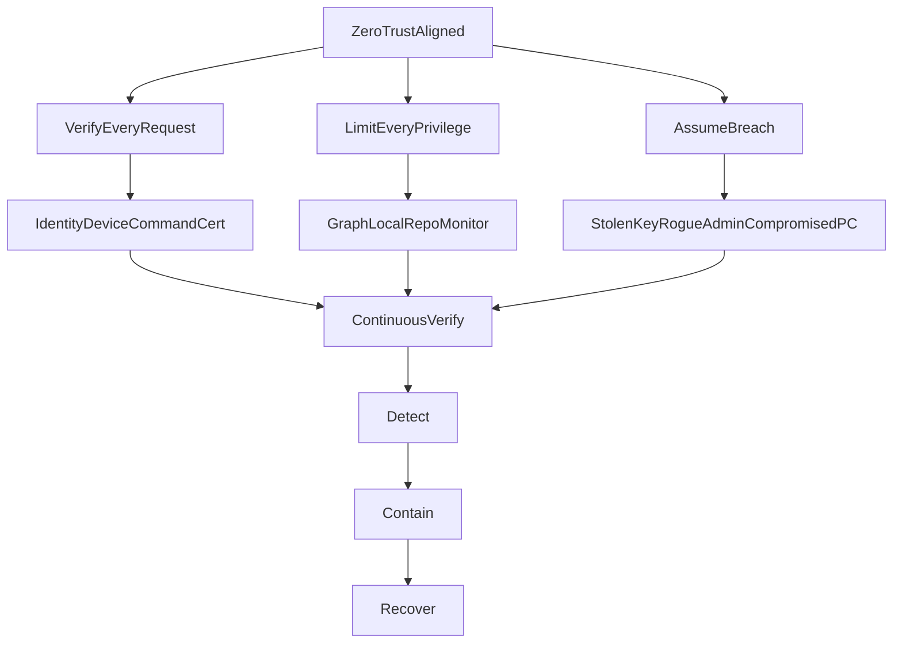

# SyncMe 2.1 Security Architecture (frozen)

> **Status:** Frozen blueprint for SyncMe **2.1 Hardening**. Audit Phases 1–4 ship through **1.7.0**; remaining items below are true 2.1 Criticals / Important work.  
> **Product roadmap:** [V2.md](../V2.md)  
> **Operator policy (current 1.x):** [SECURITY.md](../SECURITY.md)  
> **Fleet cutover:** [LOCALOPS_INTEGRATION.md](LOCALOPS_INTEGRATION.md)  
> **Product audit Phase 1:** [SYNCME-PRODUCT-AUDIT.md](../SYNCME-PRODUCT-AUDIT.md)

This is the security source of truth for Cursor and implementers. Contracts below remain the target; see **§0 Shipped vs remaining** for what is already in a customer build.

---

## 0. Shipped vs remaining (track this)

### Shipped in 1.5.x–1.6.0 (through Phase 3 foundation)

| Item | Where | Notes |
|------|--------|--------|
| LocalOps loopback register | `Modules/LocalOpsClient.ps1` | Same-host SyncMe tab discovery |
| Fleet dual-write (Monitor URL + LocalOps sites heartbeat) | `MonitorClient` + `LocalOpsClient` | Shared Bearer = `syncMeFleetToken`; not per-device certs |
| Monitor package deprecated (still built) | README / build notes | Prefer LocalOps Operations → SyncMe |
| Restic snapshot recovery `--latest 1 --json` | `SyncMe-Backup.ps1` | Fixes invalid `--latest --json` |
| Path / restore destination guards | `Modules/Security.ps1`, wired in Restore / Host | Block `..`, ADS patterns; refuse restore into Windows / Program Files / ProgramData / live repo |
| Empty restore target + unsafe path enforcement | `Test-SyncMeRestoreTargetSafe` | Non-empty rejected; drive roots / sources / archive / install (except `Restores\`) refused; re-check before restic |
| CSRF + Origin/Host + JSON content-type | `SyncMe-Host.ps1` + `ui/js/app.js` | Session CSRF (`X-SyncMe-CSRF`); mutating APIs only |
| CredWrite for Credential Manager | `Set-CmdKeyGeneric` | No password on `cmdkey` argv |
| Atomic backup lock | `Enter-BackupRunLock` | `FileMode.CreateNew`; never steal lock from a live owner by age alone |
| Fleet degraded for restic exit 3 | Heartbeat `status`/`phase` + Monitor UI | Partial backups no longer look healthy |
| Monitor placeholder token refused | `SyncMe-Monitor-Host.ps1` | Auto-generate strong token; `Bind=loopback` default; no query-string auth; static path containment |
| DPAPI task elevation handoff | `Register-BackupTask.ps1` | No plaintext elev temp file; fail-closed ACL |
| Repo job coordination | `Modules/Jobs.ps1` | Unique repos per set; idle checks before backup/restore/delete/mount |
| HTTPS + signed update manifests | `Modules/Update.ps1` + `UpdatePublicKey.xml` | RSA signature over version/file/sha256/url; SHA-256 retained |
| Staged update + merge rollback | Update apply script | `Logs/update-state.json`; restore previous-release on merge/parse failure |
| API request basics | `Assert-SyncMeApiRequestBasics` | Method allow-list; query/path size limits |
| Pester security suite + CI | `Tests/`, `.github/workflows/pester.yml` | Phase 1/2 regression coverage |
| Dumb Host + Router/controllers | `Modules/Router.ps1`, `Modules/Controllers/*` | API dispatch separated from bind loop; `/api/health` |
| ProcessRunner | `Modules/ProcessRunner.ps1` | Shared external process spawn (no secrets on argv) |
| JobState files | `Modules/Jobs.ps1` / `Data/Jobs` | Host writes backup job state; repo idle coordination |
| Config schema migration | `Modules/ConfigMigrate.ps1` | schema-version.txt v2 + options defaults |
| Structured logs + health probe | `Modules/Logging.ps1`, `Modules/Health.ps1` | `Logs/syncme-structured.log`, `/api/health` |
| RescueKit (independent of healthy Host) | `RescueKit/SyncMe-Rescue.ps1` | Stop, RestorePrevious, ValidateConfig, Diagnostics, SafeMode |
| Append-only policy (UI/API skip prune / block delete) | Existing 1.3+ set option | Not restic append-only keys / split destructive credentials |
| Advisory weekly restore drill | Existing | Elevated in 1.8.0 with hash/read evidence |
| Watchdog restore verification evidence | `Test-SyncMeRestoreDrill` + Watchdog + Health | SHA-256 + read test → `restore-verify-evidence.json`; Watchdog alerts if stale |
| SECRET log class never persisted | `Modules/Logging.ps1` | SECRET + secret-like payloads redacted |
| Reparse/symlink reject on safe paths | `Assert-SyncMeSafePath` | Blocks reparse points / intermediate junctions |

### Shipped in 1.9.0 (2.1 Criticals slice)

| Item | Where | Notes |
|------|--------|--------|
| Operator session + CSRF deepen | `Security.ps1`, Host, `app.js` | `X-SyncMe-Session` + CSRF; TTL 12h; `Data/Session/`; destructive `X-SyncMe-Confirm: 1` |
| ModuleEntra | `Modules/ModuleEntra.ps1`, Health, Operations UI | Cert app auth; Graph fingerprint; Sites.Selected preference; compromise playbook (operator-driven) |
| Fleet per-device HMAC + replay | `FleetDevice.ps1`, LocalOps `SyncMeFleet.ps1` | Device headers + nonce; shared Bearer dual-write fallback one release |
| Split restic destructive CM | Sets / Backup / Restore / wizard | `ResticAdminCredentialName` for forget/prune/delete; migration WARNING |

**Do not** claim 1.9.0 is “Zero Trust complete.” Remaining Criticals/Important items below are still open.

### Still to do (2.1 / later)

| Priority | Item | Notes |
|----------|------|--------|
| Critical | Remote command execute-once schema (if commands ever exist) | No indefinite RCE |
| Important | Broader reparse policy on every path surface | Core Assert-SyncMeSafePath done in 1.8.0 |
| Important | ProcessRunner secret-on-argv ban (2.0 ProcessRunner) | CredWrite + DPAPI elev done |
| Important | Broader Windows integration / DR automation | Unit Pester shipped; expand matrix |
| Important | VSS lifecycle / post-op verification contracts | ModuleVSS in 2.x layout |
| Important | Explicit identity separation in runtime | Docs now; code boundaries later |
| Advanced | Managed Identity / WIF, CA for workload IDs, CAE | Document-only until 2.2 optional |
| Fleet Phase 4 | Stop shipping `SyncMe-Monitor-Setup-*.zip` | After dual-write estate cutover |

---

## 1. Naming and freeze sentences

SyncMe 2.1 is a **Zero Trust–aligned, least-privilege** Windows backup orchestration platform. It is **not** “Zero Trust because it has certificates and OAuth.”

**F1.** No component, credential, device, network location, API request, or administrator action is implicitly trusted because of its location or origin. Every privileged operation must be authenticated, authorised, validated, constrained, and auditable.

**F2.** Compromise of one component must not automatically grant control over another component.

Keep the existing product philosophy: PowerShell 5.1, file-based state (no SQLite/SQL), HttpListener, restic/rclone, DPAPI / Credential Manager, Entra app credentials. Do **not** introduce a service mesh, Redis, Kafka, Postgres, OAuth gateway product, or a security framework for its own sake.

Ransomware objective = **backup estate resilience** (append-only / immutable repository strategies, separate destructive credentials, restore verification). SyncMe is **not** an antivirus or ransomware detection product (V2 “Never Build”).



```text
                    SYNCME SECURITY MODEL

                         TRUST NOTHING
                              |
             +----------------+----------------+
             |                |                |
          Identity         Software          Data
             |                |                |
        Least privilege    Signed updates    Encryption
        Certificates       Rollback          Append-only
        CA / CAE           Integrity         Verification
        Credential         RescueKit         Restore tests
        rotation
             |
             +----------------+----------------+
                              |
                       Continuous Health
                              |
                              v
                       Detect -> Alert
                              |
                              v
                       Contain -> Recover
```

---

## 2. Threat model

Assume the attacker may obtain one or more of: SyncMe configuration, Backup PC filesystem, Graph access token, certificate private key, fleet/Monitor credential, repository credentials, administrator session.

Design goal: **single compromise ≠ entire backup estate.**

| Asset compromised | Blast radius if poorly designed | 2.1 contain / recover |
|---|---|---|
| Config / Sets.json | Paths, schedules, destinations leaked; attacker retargets jobs | No secrets in config; path validation; audit config changes; RescueKit restore previous config |
| Backup PC filesystem | Read local files, possibly Credential Manager for that account | Least-privilege Windows identity; DPAPI/CM; append-only repo so local restic cannot destroy snapshots; offline password vault |
| Graph / OAuth token | Read (or worse, write) M365 data in granted scopes | Short-lived tokens; workload-scoped permissions; permission fingerprint; revoke SP / CAE where customer Entra supports it |
| Certificate private key | Impersonate SyncMe app until revoked | Compromise playbook: disable/revoke, replace cert, re-grant minimum, validate |
| Shared fleet Bearer | Impersonate any site; poison fleet UI; if commands exist, RCE | Per-device credential + replay protection; commands execute-once and expire |
| Repository write password | New snapshots, possibly forget/prune if same key | Separate backup-write vs destructive/admin keys; storage-side immutability where available |
| Administrator / localhost UI | Full local orchestration | Session + CSRF in 2.1; still local-only bind; no remote shell; restore destination guards |

---

## 3. Identity separation

These identities must not collapse into one privileged principal.

```text
                   SYNCME
                     |
        +------------+------------+
        |            |            |
     M365 ID      Local Service   Fleet / Monitor
        |            |            |
    Graph API     Windows       Telemetry /
                  account       command channel
        |
   Human administrator (config / security only)
```

| Identity | May do | Must not do |
|---|---|---|
| M365 / Graph workload | Graph calls required for that workload | Windows backup, repo prune, fleet commands, local admin |
| Windows service / scheduled-task | Backup sources, VSS if required, repo **write**, local files as designed | Tenant-wide Graph; unrestricted repo destroy; fleet authority over other PCs |
| Fleet / Monitor | Heartbeats, authorised command schema only | Graph; restic passwords; arbitrary scripts |
| Human administrator | Configure, rotate credentials, approve dangerous restores/updates | Implicit trust from “localhost” without session/CSRF; skip path validation |

Elevation (SYSTEM / admin) is isolated to operations that genuinely require it (for example VSS), not the default Host identity.

---

## 4. ModuleEntra / OAuth

`Modules/ModuleEntra.ps1` (and `OAuthController.ps1`) own cloud identity. Authentication is **not** “how we store the token.” It is “what happens if this identity is stolen, over-permissioned, or drifts.”

### 4.1 Authentication providers

```text
Authentication Providers
|
+-- Certificate          (default for non-Azure Backup PCs)
+-- Managed Identity     (Azure-hosted SyncMe, when applicable)
+-- Workload Identity Federation  (supported external workloads; avoid stored secrets)
+-- Legacy client secret (compatibility only; not the 2.1 default)
```

### 4.2 Permission fingerprint (health ≠ token works)

Configured Graph permissions are a **monitored security property**.

```text
Configured permissions
        |
     Compare
        |
Expected fingerprint (per workload)
        |
     Match?
    /       \
  YES       NO
   |         |
Healthy   WARNING (drift)
```

A token that still authenticates after an admin granted `Sites.ReadWrite.All`, `Mail.ReadWrite`, or `Directory.Read.All` is **not** Healthy. HealthService / ModuleEntra must compare granted application permissions to the expected set for the enabled workload(s).

Workload-scoped defaults (verify each SyncMe Graph operation before locking):

| Workload | Direction |
|---|---|
| OneDrive | OneDrive-related permissions only |
| SharePoint | Prefer resource-scoped **Sites.Selected** over tenant-wide `Sites.Read.All` when Graph support and backup operations allow |
| Exchange | Exchange permissions only |

**Prefer resource-scoped permissions such as Sites.Selected over tenant-wide permissions where technically compatible.** Do not force Sites.Selected blindly; inventory required Graph calls first.

No blanket tenant administrator.

### 4.3 Credential compromise response

Expiry ≠ compromise. Stolen private key can authenticate until revoked.

```text
Certificate / credential suspected compromised
        |
Disable / revoke credential (Entra admin)
        |
Disable service principal if necessary
        |
Remove Graph permissions
        |
Generate replacement certificate (or rotate MI/WIF)
        |
Re-establish minimum permissions (fingerprint)
        |
Validate authentication
        |
Resume backup
```

SyncMe ships a **Credential Compromised** emergency procedure in UI/docs (operator-driven). Actual Entra revocation is performed by a tenant administrator. SyncMe must not resume Graph backup until fingerprint + auth validation pass.

### 4.4 Optional Entra hardening (document only — not SyncMe runtime requirements)

Where the customer’s Entra licensing and topology support it:

- Conditional Access for **workload identities** (including trusted public IP restrictions for supported single-tenant service principals)
- Workload identity protection
- Continuous Access Evaluation (CAE) so revocation/policy changes reevaluate access for supported service principals

SyncMe must remain functional without CA / CAE.

---

## 5. Fleet and command channel

Fleet UI lives in **LocalOps Console**, not SyncMe core ([LOCALOPS_INTEGRATION.md](LOCALOPS_INTEGRATION.md)). Thin clients only. Shared Bearer + `siteId` is acceptable for **1.5.x dual-write**; it is **not** sufficient for 2.1+ if the channel can impersonate devices or issue commands.

### 5.1 Device authentication (2.1+)

Minimum:

- Device ID
- Device credential (prefer **per-device certificate** or equivalent cryptographic machine credential — not `site_id=ABC123` alone)
- Request authentication
- Replay protection

Heartbeat payloads still must never include restic passwords, SMTP secrets, or rclone OAuth tokens.

### 5.2 Remote commands (if ever beyond heartbeat)

Monitor / LocalOps must not become unbounded remote execution. V2 still forbids remote shell into Backup PCs.

```text
Command
  -> Authenticated device
  -> Authorised action
  -> Schema validation
  -> Nonce / unique ID
  -> Expiration
  -> Execute once
  -> Signed / audited result
```

Required fields:

| Field | Role |
|---|---|
| `command_id` | Unique; execute **once** |
| `created` / `expires` | No indefinite commands |
| `target_device` | Bound to authenticated device |
| `action` | Allowlisted (`RUN_BACKUP`, `TRIGGER_UPDATE`, …) |
| `parameters` | Schema-validated; no free-form script |
| `issuer` | Auditable |
| `status` | Queued / executed / expired / rejected |

Dangerous actions (`RUN_RESTORE`, `RUN_SCRIPT`, `ISOLATE`, `CHANGE_CONFIG`) require explicit 2.1+ allowlist and the same path/restore rules as the local API. Replay of an old command must fail.

```text
Monitor / LocalOps
   |
   | authenticated command
   v
Device
   |
   +-- Is command valid?
   +-- Is it authorised?
   +-- Has it expired?
   +-- Has it already executed?
   +-- Are parameters safe?
```

---

## 6. Update chain

SHA-256 of a package hosted next to its own manifest is **integrity**, not **authenticity**. A compromised update host can serve matching hash + malware.

```text
Update manifest
       |
Authenticity verification (signature)
       |
Package hash verification
       |
Package validation
       |
Staging
       |
Backup current version
       |
Install
       |
Health check
       |
Commit  OR  rollback + alert
```

- **Hash = integrity. Signature = authenticity. Both required in 2.1.**  
  **1.5.2:** SHA-256 + `Logs/previous-release` + parse health auto-rollback are **shipped**. Manifest/package **signature** remains **todo**.
- Auto-rollback is **mandatory**: if Host will not start or health probe fails after 2.1.x → 2.1.y, restore previous release, restart, alert administrator.
- ProcessRunner / updater must not pass secrets on command lines.

---

## 7. RescueKit

If Host, service, config, modules, or file-state queues are broken, recovery must not depend on a healthy SyncMe Host.

Independently executable: `RescueKit/SyncMe-Rescue.ps1` (PowerShell 5.1).

**1.5.2 status:** script **ships** with Stop, RestorePrevious, ValidateConfig, Diagnostics, SafeMode. Capabilities still to deepen: module disable, richer config restore, full safe-mode module gating.

Capabilities:

- Stop service / scheduled host
- Restore previous release (from updater backup)
- Validate configuration
- Restore file-based state backups (queue/locks/config copies — **not** SQLite)
- Disable a problematic module
- Restore previous configuration
- Export diagnostics (no SECRET class)
- Start SyncMe in safe mode (Host without optional modules / fleet)

Printable Rescue Kit HTML remains: **no live passwords or tokens**.

---

## 8. Repository security and ransomware resilience

For every restic repository: encryption, credentials, integrity, locks, access, retention, pruning, verification.

**Backup credentials must be separate from restore / destructive credentials where practical.** A compromised SyncMe process should not automatically gain unrestricted forget/prune/destroy.

Headline control: **append-only / immutable strategies** (SyncMe policy plus restic append-only keys and storage WORM/object-lock where the backend supports them). 1.x append-only (skip prune / block deletes in UI) is the right direction; 2.1 treats it as estate resilience, not a WORM guarantee on every NAS.

Integrity check tiers (a successful backup ≠ a restorable backup):

| Cadence | Action |
|---|---|
| Daily | Repository / metadata check |
| Weekly | Small `restic check --read-data-subset` |
| Monthly | Larger read-data subset |
| On-demand | Full check |

---

## 9. Restore security

Backup software is an attack vector during restore.

**1.5.3:** destination validation refuses live repo / Windows / Program Files / ProgramData / drive roots / sources / archive / install (except `Restores\`); empty targets enforced; include-path `..` blocked; CSRF + Origin/Host on mutating API. Still **todo:** fuller reparse/symlink policy, overwrite confirmation UX, dry-run as first-class restore gate.

Required:

- Authorization (session/CSRF; fleet commands use §5)
- Destination validation
- Traversal / UNC / ADS / reparse / symlink policy
- Overwrite controls
- Audit logging
- Confirmation for dangerous locations
- Dry-run
- Restore destination not the live restic repository or source share

Dangerous roots must not be casually overwritten: `C:\Windows`, `C:\Program Files`, `C:\ProgramData` (and equivalents).

---

## 10. Path trust (SecurityService)

**Never trust paths received from the UI, API, configuration, or remote fleet.**

**1.5.2:** `Modules/Security.ps1` provides `Assert-SyncMeSafePath`, dangerous Windows-root checks, and restore-include `..` rejection, wired into restore flows.

Protect against: `..\..\Windows`, `C:\Windows`, unexpected UNC, alternate data streams, reparse points, symbolic links.

`Assert-SafePath` (and restore destination checks) must normalize, reject `..` after resolution, constrain roots, and apply a reparse/symlink policy appropriate to backup vs restore. The illustrative snippet in V2.md is a starting contract, not a complete implementation.

---

## 11. VSS (ModuleVSS)

Do not treat `--use-fs-snapshot` as a security or correctness story by itself.

Validate: administrative requirements, VSS availability, shadow-copy create failure, stale snapshots, cleanup, snapshot lifecycle, disk-space exhaustion.

**Successful VSS invocation ≠ valid backup.** BackupEngine must perform post-operation verification (restic summary / snapshot id / integrity policy).

---

## 12. Recovery Verification (Watchdog)

Selected critical files (per set policy):

```text
Backup
  -> Restore to temporary location (safe dest)
  -> Hash / size validation
  -> Open / read test where practical
  -> Delete temporary restore
```

**1.8.0:** weekly/manual restore verification writes `Logs/sets/<id>/restore-verify-evidence.json` (size, SHA-256, readBytes). Watchdog and `/api/health` treat missing/stale evidence as attention. Still advisory for job success unless `FailJobOnRestoreDrillFailure` is enabled. Not a substitute for operator disaster drills.

---

## 13. Secrets and PowerShell

Never pass secrets or bearer tokens as **command-line arguments**.

Disable or sanitize transcript, verbose, and diagnostic output around authentication. Assume `$Error`, process listings, and crash dumps may leak; keep secrets in env/DPAPI for the shortest possible window (existing Credential Manager pattern).

ProcessRunner is the only restic/rclone spawn path; it inherits this rule.

---

## 14. Logging classification

| Class | Persist? | Use |
|---|---|---|
| INFO | Yes | Routine progress |
| WARNING | Yes | Non-fatal issues |
| ERROR | Yes | Failures |
| SECURITY | Yes | Authz failures, path rejects, drift, compromise procedure started |
| AUDIT | Yes | Privileged actions (restore, prune, update, credential store, fleet command) |
| SECRET | **Never** | Tokens, passwords, cert material — do not write |

Structured events still include Timestamp, Source, Component, JobId, Message, Duration, ExitCode (V2 §13). SECRET must not appear in HTML reports, Rescue Kit, or support zips.

---

## 15. Localhost UI / API (2.1)

The browser is never trusted. Local bind (`127.0.0.1`) is a **network** control, not authorization.

```text
Browser -> API -> Authenticate -> Authorise -> Validate -> Execute
```

1.5.3 adds CSRF + Origin/Host on mutating routes; 2.1 may still deepen the session model. 1.x “you are on the Backup PC” remains the operator trust model in SECURITY.md; design must not treat localhost as implicit permission to skip validation.

---

## 16. Phasing

Status of each item: **done (1.5.2)** / **partial** / **todo**. See also §0.

### Critical (2.1 must-have contracts)

1. Credential compromise / revocation playbook — **todo**  
2. Permission drift fingerprint — **todo**  
3. Fleet / device authentication (beyond shared Bearer) — **todo** (1.5.x = shared Bearer dual-write only)  
4. Remote command replay protection — **todo** (no remote command channel yet; keep forbidden remote shell)  
5. Signed updates + mandatory rollback — **partial** (SHA-256 + previous-release parse rollback in 1.5.2; signature **todo**)  
6. Backup repository destruction protection (append-only / split credentials) — **partial** (UI append-only exists; split keys / storage WORM **todo**)  
7. Restore security — **partial** (dangerous roots + path guards in 1.5.2; full reparse/overwrite UX **todo**)  
8. Restore verification (Watchdog / HealthService) — **partial** (advisory drill exists; evidence drill **todo**)

### Important (2.1 contracts; implement with engines)

9. VSS lifecycle and error handling — **todo** (2.x ModuleVSS)  
10. PowerShell secret leakage — **partial** (Credential Manager pattern; harden ProcessRunner in 2.0)  
11. Security-classified logging — **todo**  
12. Path traversal / reparse protection — **partial** (`Modules/Security.ps1` in 1.5.2)  
13. Identity separation — **todo** (documented; runtime split later)  
14. Resource-scoped Graph permissions (Sites.Selected) — **todo**  
15. Threat model (this document) — **done** (docs)

### Advanced (2.1 documentation; 2.2 optional runtime)

16. Managed Identity / Workload Identity Federation — **todo**  
17. Conditional Access for workload identities — **todo** (document-only OK)  
18. Continuous Access Evaluation — **todo** (document-only OK)  
19. Automated permission / credential audits beyond fingerprint warn — **todo**

### Implementation order (remaining)

1. Session/CSRF on mutating API (SecurityService)  
2. ModuleEntra fingerprint + compromise playbook (docs/UI)  
3. UpdateEngine **signature** (keep existing hash + rollback)  
4. Repo append-only keys / split destructive credentials  
5. Fleet device auth (LocalOps) + command-once schema if commands appear  
6. Integrity tiers + Watchdog restore verification  
7. Log classes + VSS lifecycle contracts (with 2.0 engines)  

---

## 17. Related

- [V2.md](../V2.md) — platform contracts, non-negotiables  
- [SECURITY.md](../SECURITY.md) — 1.x operator / researcher policy  
- [LOCALOPS_INTEGRATION.md](LOCALOPS_INTEGRATION.md) — register vs fleet ingest  
